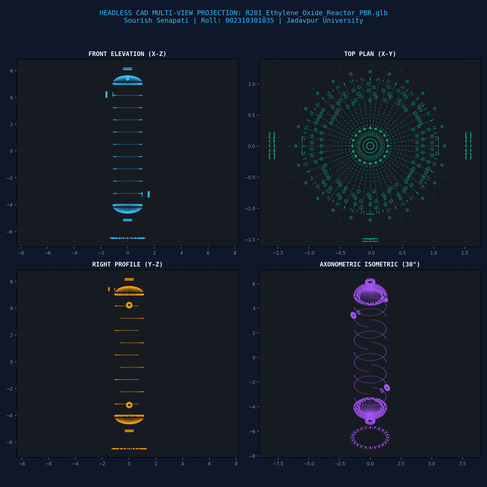

# Agent-Native CAD & Chemical Simulation Toolkit

First-principles, zero-GUI programmatic CAD topology extraction, ASME Section VIII Division 1 mechanical verification, and coupled packed-bed reactor ODE solvers. Built for autonomous AI agents (Claude, Cursor, Windsurf, Antigravity) and high-throughput engineering pipelines.

Authored by **Sourish Senapati** (Roll: `002310301035`), Department of Chemical Engineering, Jadavpur University.

---

## 1. Design Philosophy: The Agent CAD Paradigm

Modern computer-aided design (SolidWorks, CATIA, AutoCAD) is optimized for human motor skills: manipulating 60 FPS mouse pointers, hovering over contextual ribbons, and rotating orbit controls. Autonomous LLM agents fail in this paradigm because visual mouse interactions hallucinate scale and cannot be inspected programmatically.

The **Agent CAD Paradigm** replaces GUI interaction with three deterministic, first-principles interfaces:
1. **Machine-Readable B-Rep Topology**: Exact boundary representations, watertightness, convex hulls, centroids, and volumes emitted as clean JSON trees (`cad_inspect_topology`).
2. **Deterministic Mechanical & Kinetic ODE Solvers**: Closed-form ASME BPVC formulas and 4th-Order Runge-Kutta (RK4) numerical integration for chemical reactor hydraulics and reaction kinetics (`cad_verify_asme_pressure_vessel`, `cad_solve_packed_bed_hydraulics_kinetics`).
3. **Multi-View Orthographic Visual Tokens**: Zero-X11, headless rasterization producing synchronized Front, Top, Right, and Isometric projections (`cad_render_multiview_projections`) for multimodal vision models.

```
       +-------------------------------------------------------+
       |                  Autonomous AI Agent                  |
       |             (Claude / Cursor / Antigravity)           |
       +-------------------------------------------------------+
                |                    |                     |
      tools/call (JSON-RPC)          | (Image input)       | (Direct CLI)
                v                    v                     v
   +-------------------------+  +----------+   +-------------------------+
   |   cad_mcp_server.py     |  | 4-View   |   |   cad_agent_toolkit.py  |
   | (Model Context Protocol)|  | PNG Sync |   |  (Python/NumPy/Trimesh) |
   +-------------------------+  +----------+   +-------------------------+
                |                                          |
                +--------------------+---------------------+
                                     |
                                     v
       +-------------------------------------------------------+
       |   Ethylene Oxide Industrial Multi-Tubular Reactor     |
       |  - ASME BPVC Section VIII Div 1 Design Rules          |
       |  - Shell & Tube Bundle: 7,654 Tubes @ 6.70m Length    |
       |  - Ergun Hydraulics + Silver/Alumina Catalytic RK4    |
       +-------------------------------------------------------+
```

---

## 2. Governing Equations

### 2.1 ASME BPVC Section VIII Division 1 Verification

For internal design pressure $P = 2.1\text{ MPa}$ ($21.0\text{ bar}$), inner diameter $D_i = 2133.6\text{ mm}$ ($R_i = 1066.8\text{ mm}$), material SA-240-304L (allowable stress $S = 115.0\text{ MPa}$ at $230^\circ\text{C}$), weld joint efficiency $E = 1.0$, and corrosion allowance $C_A = 3.0\text{ mm}$:

#### Cylindrical Shell (ASME UG-27(c)(1))
The minimum required thickness under circumferential hoop stress:

$$t_{\text{shell}} = \frac{P \cdot R_i}{S \cdot E - 0.6 \cdot P} + C_A$$

$$\text{Denominator} = 115.0(1.0) - 0.6(2.1) = 113.74\text{ MPa}$$

$$t_{\text{shell}} = \frac{2.1 \times 1066.8}{113.74} + 3.0 = 19.697\text{ mm} + 3.0\text{ mm} = 22.70\text{ mm}$$

#### 2:1 Ellipsoidal Dished Head (ASME UG-32(d))
For an ellipsoidal head with major-to-minor axis ratio of 2:1 ($K = 1.0$):

$$t_{\text{head}} = \frac{P \cdot D_i \cdot K}{2 \cdot S \cdot E - 0.2 \cdot P} + C_A$$

$$\text{Denominator} = 2(115.0)(1.0) - 0.2(2.1) = 229.58\text{ MPa}$$

$$t_{\text{head}} = \frac{2.1 \times 2133.6 \times 1.0}{229.58} + 3.0 = 19.516\text{ mm} + 3.0\text{ mm} = 22.52\text{ mm}$$

*Design Audit*: Fabricated nominal wall thickness is $25.4\text{ mm}$ ($1.00\text{ inch}$), yielding a safety margin of $+11.9\%$ over ASME minimum code requirement.

---

### 2.2 Coupled Fixed-Bed Reactor Hydraulics & Non-Isothermal Kinetics

The multi-tubular catalytic bed (7,654 tubes, $D_{t,\text{in}} = 21.18\text{ mm}$, $L = 6.70\text{ m}$) integrates three coupled differential equations:

#### 1. Momentum Conservation (Ergun Equation)
$$\frac{dP}{dz} = -\left[ 150 \frac{(1-\varepsilon)^2}{\varepsilon^3 d_p^2} \mu v_s + 1.75 \frac{1-\varepsilon}{\varepsilon^3 d_p} \rho v_s^2 \right]$$

#### 2. Species Mass Conservation (Ethylene Conversion $X$)
$$\frac{dX}{dz} = \frac{\frac{\pi D_t^2}{4} \cdot \rho_{\text{bed}} \cdot (-r_{\text{eth}})}{F_{\text{eth},0}}$$

Where the total ethylene reaction rate is the sum of partial epoxidation ($r_1$) and moderated total combustion ($r_2$):
- $r_1 = k_1(T) \cdot p_{\text{C}_2\text{H}_4} \cdot p_{\text{O}_2}^{0.5}$ ($\Delta H_1 = -106.7\text{ kJ/mol}$)
- $r_2 = k_2(T) \cdot p_{\text{C}_2\text{H}_4} \cdot p_{\text{O}_2}^{1.5}$ ($\Delta H_2 = -1323.0\text{ kJ/mol}$)

#### 3. Thermal Energy Conservation
$$\frac{dT}{dz} = \frac{\pi D_t U (T_c - T) + \frac{\pi D_t^2}{4} \rho_{\text{bed}} \left[ (-\Delta H_1) r_1 + (-\Delta H_2) r_2 \right]}{\dot{m}_{\text{tube}} \cdot C_{p,\text{gas}}}$$

Integrated along $z \in [0, 6.70\text{ m}]$ using explicit 4th-Order Runge-Kutta (RK4) with $N = 200$ axial discretization steps ($\Delta z = 33.5\text{ mm}$).

---

## 3. Quickstart & CLI Usage

### Verify ASME Section VIII Div 1
```bash
py scripts/cad_agent_toolkit.py verify-asme --component shell --pressure-bar 21.0 --diameter-mm 2133.6 --material SA-240-304L
```
*Output*:
```json
{
  "t_min_req_mm": 22.6965,
  "t_corroded_mm": 19.6965,
  "denominator": 113.74,
  "material": "SA-240-304L",
  "allowable_stress_mpa": 115.0,
  "design_pressure_mpa": 2.1
}
```

### Solve Packed-Bed Reactor Kinetics & Hydraulics
```bash
py scripts/cad_agent_toolkit.py solve-pbr --flow-kg-h 58240.0 --temp-c 230.0 --coolant-c 225.0 --pressure-bar 21.0
```
*Output*:
```json
{
  "exit_conversion_pct": 14.92,
  "peak_hotspot_temp_c": 230.0,
  "exit_temp_c": 226.00,
  "inlet_pressure_bar": 21.0,
  "exit_pressure_bar": 20.416,
  "pressure_drop_bar": 0.584,
  "profile_datapoints": 200
}
```

### Inspect CAD Model Topology (GLB / STEP / STL)
```bash
py scripts/cad_agent_toolkit.py inspect "Ethylene_Oxide_Reactor_Drawings/cad/glb/R201_Ethylene_Oxide_Reactor_PBR.glb"
```

### Render 4-View Orthographic Projections
```bash
py scripts/cad_agent_toolkit.py render-multiview "Ethylene_Oxide_Reactor_Drawings/cad/glb/R201_Ethylene_Oxide_Reactor_PBR.glb" --output "assets/cad_multiview.png"
```



---

## 4. Model Context Protocol (MCP) Server Setup

The toolkit provides an out-of-the-box MCP server conforming to the official `2024-11-05` specification.

### 4.1 Claude Desktop Configuration
Add the server entry to `%APPDATA%\Claude\claude_desktop_config.json`:
```json
{
  "mcpServers": {
    "cad-engineering": {
      "command": "py",
      "args": [
        "d:\\GAMES\\zercxes\\CAD_Engineering_Drawings\\scripts\\cad_mcp_server.py"
      ]
    }
  }
}
```

### 4.2 Cursor / Windsurf / Antigravity MCP Configuration
Add to `.cursor/mcp.json` or `.gemini/antigravity/mcp/cad_server.json`:
```json
{
  "mcpServers": {
    "cad-engineering": {
      "command": "py",
      "args": [
        "d:/GAMES/zercxes/CAD_Engineering_Drawings/scripts/cad_mcp_server.py"
      ]
    }
  }
}
```

### 4.3 Available Agent Tools

| Tool Name | Parameters | Description |
|---|---|---|
| `cad_inspect_topology` | `file_path` | Returns hierarchical B-Rep bodies, face counts, vertex counts, centroids, bounding boxes, and watertight status. |
| `cad_verify_asme_pressure_vessel` | `design_pressure_bar`, `inner_diameter_mm`, `material`, `joint_efficiency`, `corrosion_allowance_mm` | Computes ASME UG-27(c)(1) shell and UG-32(d) 2:1 ellipsoidal head minimum required thicknesses. |
| `cad_solve_packed_bed_hydraulics_kinetics` | `num_tubes`, `feed_flow_kg_h`, `feed_temp_c`, `coolant_temp_c`, `feed_pressure_bar` | Numerical RK4 ODE solver coupling Ergun pressure loss and exothermic catalytic epoxidation kinetics. |
| `cad_render_multiview_projections` | `cad_file_path`, `output_png_path` | Generates headless 4-view orthographic drawing raster (Front, Top, Right, Isometric) for vision LLMs. |

---

## 5. VS Code / Cursor Native Extension Integration

The bundled `cad-native-viewer` extension exposes the command:
```
CAD: Export Machine-Readable Context for AI Agents (JSON & Projections)
```
- Command ID: `cadNativeViewer.exportAgentContext`
- Automatically invokes `cad_agent_toolkit.py` to emit `<model>.agent_context.json` and `<model>.multiview.png` directly into the active workspace, making any open 3D model immediately readable by reasoning and vision agents.
